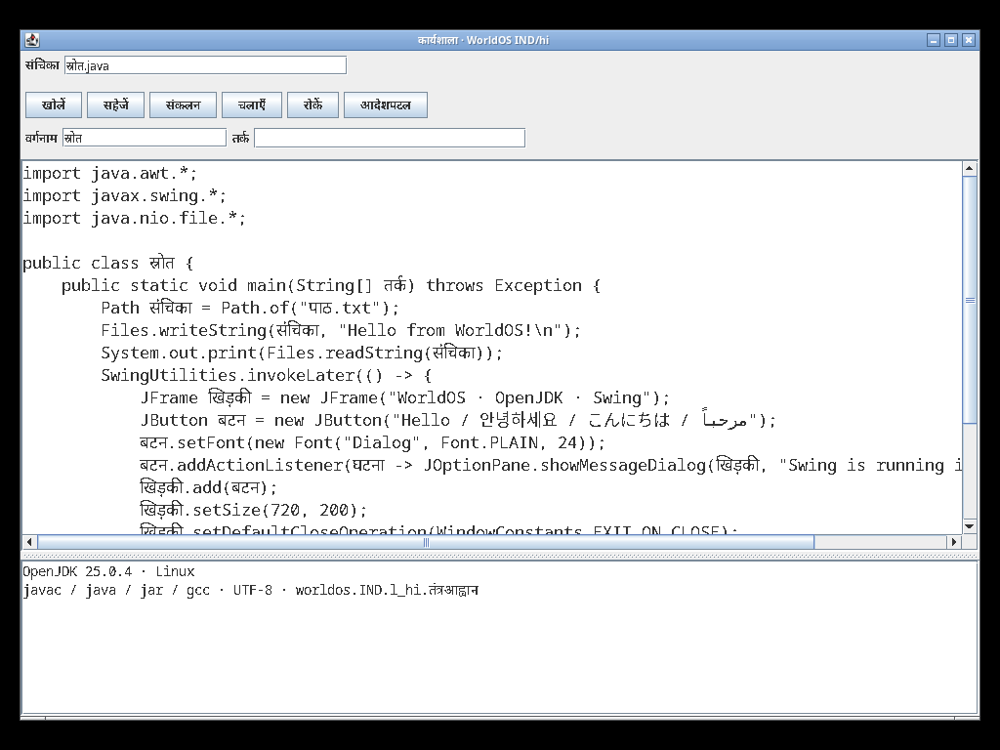
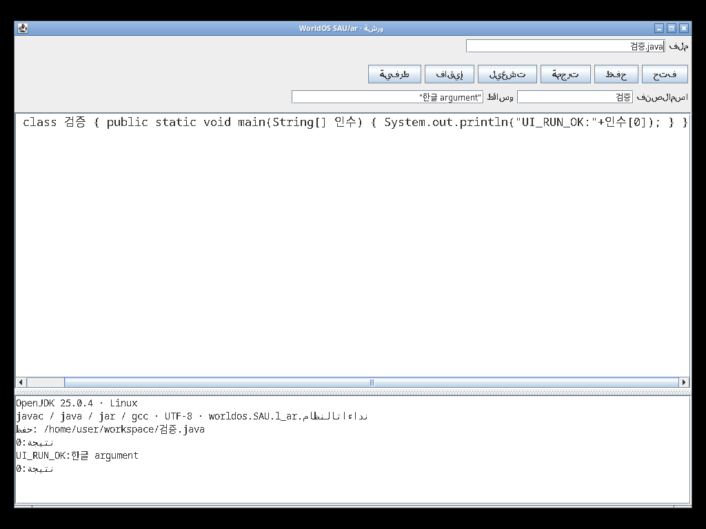

# 검증 범위

2026-09-13~14, x86_64 Linux 호스트의 OpenJDK 11 컴파일러와 QEMU 2.11 TCG에서 검사했다. 게스트는 Linux 6.18.50-0-virt, Alpine 3.24, OpenJDK 25.0.4+7이다. [실행 이미지 해시](verification/runtime.json), [검사한 소스 해시](verification/source-sha256.json), [설치한 455개 패키지](runtime/packages.lock.json)를 함께 보관한다.

| 범위 | 확인한 결과 |
|---|---|
| 249개 국가·지역, 1,578개 판 | Java 컴파일, 국가별 JAR 클래스 분리, 모든 C 헤더 컴파일, 생성 파일 17,358개의 해시 확인 |
| 한국어 전체 기능, 2회 부팅 | 파일·링크·메모리 매핑, 게스트 javac/java/jar, 스레드, TCP/UDP, HTTP/HTTPS, DNS, 리플렉션/JIT, Swing/Robot, 편집기 실행, C/POSIX, JNI, 유니코드 입력, 재부팅 후 파일 보존 |
| 아랍어 Xorg 데스크톱 | 글꼴, 예제 로드, 편집·저장·컴파일·실행, C/POSIX·현지화 함수, 유니코드 키보드 입력, 정상 종료와 ext4 무결성 |
| 아랍어 화면 배치 후속 시험 | 도구 모음의 RTL 배치를 유지하면서 코드창을 출력창 위에 고정, 저장·컴파일·실행 재확인 |
| 힌디어 독립판 일반 부팅 | 다른 국가 디렉터리 없이 컴파일, 실제 GUI 표시, 직렬 콘솔의 유니코드 Java 컴파일·실행, 파일 기록, poweroff 종료, ext4 무결성 |
| 글꼴 | Dialog·Monospaced에서 27개 언어·문자 표본의 글리프 확인. 힌디어 화면도 직접 확인 |
| 입력기 설정 | 실제 게스트에 등록된 963개 엔진과 778개 언어 프로필 대조, 존재하지 않는 엔진 참조 0개 |

기계가 읽는 결과: [판별 빌드](verification/editions.json), [한국어 전체 시험](verification/kor-full.json), [아랍어 데스크톱](verification/arabic-desktop.json), [아랍어 배치](verification/arabic-layout.json), [힌디어 일반 부팅](verification/hindi-normal.json), [입력기 대조](verification/input-engines.json).

한국어 전체 기능 시험 후 글꼴 묶음과 편집기 배치를 보완했으며, 변경한 표시·배치·콘솔 경로는 후속 그래픽 시험으로 확인했다. 부팅 시험은 전용 ext4 디스크를 사용한다. 성공 판정에는 시험 표식, 정상 종료 표식, e2fsck 결과와 저널 복구 경고 부재를 포함한다. 전체 직렬 로그·원본 화면·디스크는 `build/verification/`에 남는다.

1,578개 판을 각각 부팅한 결과는 아니다. 모든 JDK/POSIX API, 장치 드라이버, 문자 조합·입력 방식의 전수 검증 또는 POSIX 인증을 뜻하지 않는다. 27개 표본은 전체 유니코드 범위나 모든 언어의 조판 품질을 보증하지 않는다. 언어별 번역 제안 중 1,226개 판에 미번역 개념이 남아 있으며, 모든 판의 원어민·어원 검토는 대기 상태다.
